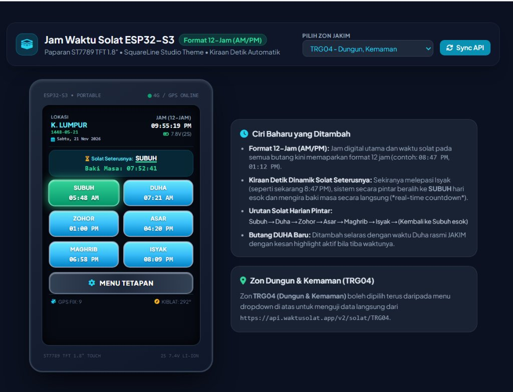

# Simulator Jam Waktu Solat Pintar (SquareLine Studio Style)

<p align="center">
  
</p>

Simulator antaramuka web interaktif (*Interactive UI Simulator*) untuk prototaip **Jam Waktu Solat Pintar Mudah Alih (Travel / Portable Smart Prayer Clock)**. Antaramuka ini direka khas mengikut estetika moden **SquareLine Studio / LVGL** untuk paparan skrin **TFT 1.8" ST7789 Touchscreen**.

---

## 🌟 Ciri-Ciri Utama Simulator

- **Sokongan API Rasmi JAKIM (Live):** Mengambil data waktu solat secara masa nyata (*real-time*) daripada `https://api.waktusolat.app/` merangkumi 60 zon di seluruh Malaysia (termasuk Dungun/Kemaman `TRG04`, Shah Alam `SGR01`, Kuala Lumpur `WLY01`, dll.).
- **Format 12-Jam (AM/PM):** Jam digital utama dan kesemua butang waktu solat memaparkan format 12 jam berserta penunjuk `AM/PM`.
- **Kiraan Detik Baki Masa Dinamik (*Next Prayer Countdown*):**
  - Mengira baki masa secara langsung ke waktu solat yang seterusnya.
  - Selepas waktu Isyak berlalu, label secara automatik beralih kepada **SUBUH** (hari esok) dan mengira baki masa sehingga Subuh keesokan harinya.
  - Urutan pintar: `Subuh` ➔ `Duha` ➔ `Zohor` ➔ `Asar` ➔ `Maghrib` ➔ `Isyak` ➔ `Subuh`.
- **Butang Waktu DUHA:** Dilengkapi waktu Duha rasmi JAKIM dengan butang bersorotan aktif (*glowing pulse*).
- **Dua Kalendar Serentak:** Memaparkan **Kalendar Hijrah** dan **Kalendar Sebenar (Masihi)** di bawah label lokasi.
- **Simulasi Menu Tetapan Interaktif:**
  - 🧭 **Arah Kiblat:** Simulasi kompas digital magnetik (sudut ~292.8° di Semenanjung ke arah Kaabah).
  - 🛰️ **Kordinat GPS:** Paparan status kunci satelit (3D Fix) dan pengesanan zon terdekat.
  - ⏰ **Tetapan Jam (RTC):** Simulasi masa tepat cip RTC DS1307.
  - 🌙 **Kalendar Hijrah:** Perincian waktu Imsak, Syuruk, dan Dhuha.

---

## 🚀 Cara Menjalankan Simulator

### 1. Buka Secara Tempatan (Local)
1. Muat turun (*download*) atau klon (*clone*) repositori ini.
2. Buka fail `index.html` menggunakan pelayar web seperti **Google Chrome**, **Microsoft Edge**, atau **Firefox**.
3. Pilih mana-mana zon JAKIM daripada menu pilihan untuk melihat waktu solat dikemaskini serta-merta.

### 2. Mengaktifkan Laman Web Percuma melalui GitHub Pages
Anda boleh menjadikan repositori ini sebagai laman web yang boleh diakses oleh sesiapa sahaja di internet:
1. Di repositori GitHub anda, klik pada tab **Settings**.
2. Di menu sebelah kiri, pilih **Pages**.
3. Di bahagian **Branch**, pilih `main` (atau `master`) dan folder `/ (root)`, kemudian klik **Save**.
4. Dalam beberapa minit, GitHub akan memberikan pautan laman web anda:
   `https://<username-anda>.github.io/<nama-repo>/`

---

## 📁 Struktur Repositori

```text
├── index.html        # Fail antaramuka web simulator lengkap (HTML, Tailwind CSS & JS)
├── screenshots/      # Gambar pratonton dan lakaran UI
│   ├── preview_simulator.jpg
│   ├── waktu_solat.png
│   └── menu.png
└── README.md         # Dokumentasi projek
```

---

## 📜 Hak Cipta & Lesen

Hak cipta terpelihara. Projek ini dibangunkan untuk tujuan simulasi konsep reka bentuk antaramuka produk perkakasan jam waktu solat mudah alih.
